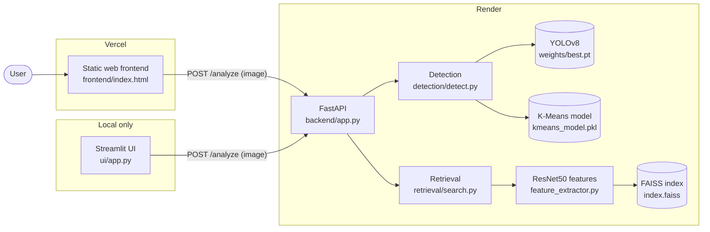
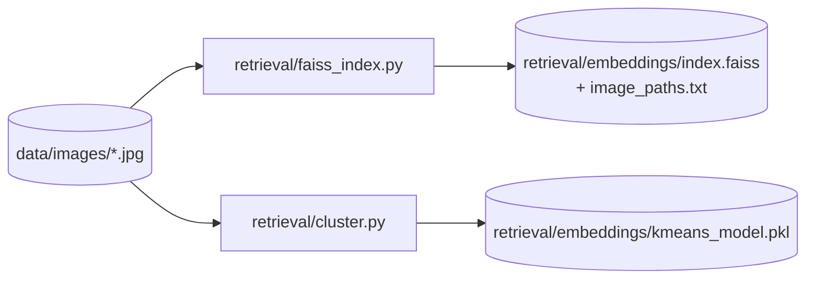

# 🛰️ SkyNetra — Satellite Visual Search, Retrieval and Detection System

<p align="center">
  <a href="https://skynetra-frontend.vercel.app"><b>🌐 Live App</b></a> ·
  <a href="https://skynetra-api-58v6.onrender.com"><b>⚙️ Live API</b></a> ·
  <a href="https://skynetra-api-58v6.onrender.com/docs"><b>📖 API Docs (Swagger)</b></a>
</p>

| Component | Hosted on | URL |
| --- | --- | --- |
| Frontend (web UI) | Vercel | https://skynetra-frontend.vercel.app |
| Backend (FastAPI) | Render | https://skynetra-api-58v6.onrender.com |

> ⏳ The backend runs on Render's free tier, which sleeps when idle. The **first request after a pause can take ~1 minute** while the server wakes up and loads the model. Later requests are fast.

SkyNetra is an end-to-end modular AI pipeline that **detects objects**, **generates YOLO labels**, **retrieves visually similar images**, and **clusters unknown objects** in satellite imagery using a hybrid supervised + unsupervised approach.

---

## 📌 Table of Contents

- [Features](#-features)
- [Architecture](#️-architecture)
- [Project Structure](#-project-structure)
- [Tech Stack](#-tech-stack)
- [Run Locally](#-run-locally)
- [API Reference](#-api-reference)
- [How Semi-Supervised Learning Works](#-how-semi-supervised-learning-works)
- [Deployment](#-deployment)
- [Troubleshooting](#-troubleshooting)
- [Dataset](#️-dataset)

---

## ✨ Features

- 🔍 **Object Detection** — YOLOv8 fine-tuned on a 14-class satellite dataset
- 🏷️ **Auto Label Generation** — produces YOLO-format `.txt` annotation files
- 🔁 **Visual Similarity Search** — ResNet50 embeddings + FAISS return the top-5 similar images
- 🧠 **Semi-Supervised Learning** — confident detections keep their YOLO label; uncertain ones are grouped by K-Means clustering
- ⚡ **FastAPI Backend** — one `/analyze` endpoint runs detection and retrieval
- 🖥️ **Two UIs** — a static web frontend (deployed on Vercel) and a Streamlit app (for local use)

---

## 🏗️ Architecture



### Request flow

1. The user uploads a satellite image in the web UI.
2. The frontend sends it as `multipart/form-data` to `POST /analyze` on the backend.
3. The backend saves the image temporarily and runs two modules:
   - **Detection** — YOLOv8 predicts boxes (confidence ≥ 0.3). Boxes with confidence ≥ 0.6 are *supervised* (YOLO label kept, green box). Lower-confidence boxes are *unsupervised*: the crop's colour histogram is assigned a K-Means cluster (orange box). The module draws an annotated image and writes a YOLO label file.
   - **Retrieval** — ResNet50 turns the image into a 2048-dim normalised vector, and FAISS returns the 5 nearest images from the indexed dataset.
4. The backend returns one JSON response. The annotated image (base64) and label file text are included inline, so the frontend can display and download them without extra requests.
5. The frontend renders the detections, learning-mode breakdown, annotated image, label download, and similar images.

### Offline steps (build once)



These artifacts are generated from your own image dataset and are **not committed** to git. Without them the app still works: detection runs normally, unknown objects are labelled `Unknown Object (<label>?)`, and similarity search returns an "Index not built" message.

---

## 📁 Project Structure

```
SkyNetra/
├── backend/
│   └── app.py                 ← FastAPI app: /, /analyze, /outputs
├── detection/
│   ├── __init__.py
│   └── detect.py              ← YOLOv8 detection + auto-labelling + semi-supervised logic
├── retrieval/
│   ├── __init__.py
│   ├── feature_extractor.py   ← ResNet50 feature extraction (lazy-loaded)
│   ├── faiss_index.py         ← Builds the FAISS index from data/images/
│   ├── search.py              ← Similarity search
│   ├── cluster.py             ← K-Means clustering for unknown objects
│   └── embeddings/            ← Generated index + cluster model (git-ignored)
├── frontend/
│   ├── index.html             ← Static web UI (deployed on Vercel)
│   └── config.js              ← Backend URL used by the web UI
├── ui/
│   └── app.py                 ← Streamlit UI
├── weights/
│   └── best.pt                ← Fine-tuned YOLOv8 model
├── data/images/               ← Your satellite images (git-ignored)
├── outputs/                   ← Annotated image + label file (generated)
├── render.yaml                ← Render service definition
├── requirements.txt
├── packages.txt               ← System packages (libGL) for hosted Python platforms
└── README.md
```

---

## 🧰 Tech Stack

| Component | Technology |
| --- | --- |
| Object detection | YOLOv8 (Ultralytics) |
| Feature extraction | ResNet50 (PyTorch / torchvision) |
| Similarity search | FAISS |
| Unsupervised clustering | K-Means (scikit-learn) |
| Image processing | OpenCV, Pillow |
| Backend API | FastAPI + Uvicorn |
| Web frontend | HTML, CSS, vanilla JavaScript |
| Local UI | Streamlit |
| Hosting | Render (backend), Vercel (frontend) |

---

## 💻 Run Locally

### Prerequisites

- Python 3.10 (3.8+ should work)
- Git
- ~3 GB free disk space for PyTorch and other dependencies

### 1. Clone the repository

```bash
git clone https://github.com/parth-05122005/SkyNetra.git
cd SkyNetra
```

### 2. Create and activate a virtual environment

```bash
# Windows
python -m venv venv
venv\Scripts\activate

# macOS / Linux
python3 -m venv venv
source venv/bin/activate
```

### 3. Install dependencies

```bash
pip install -r requirements.txt
```

`requirements.txt` installs the CPU-only build of PyTorch. If you have an NVIDIA GPU and want CUDA, install `torch`/`torchvision` from [pytorch.org](https://pytorch.org/get-started/locally/) first.

### 4. Check the model weights

The fine-tuned model is already included at `weights/best.pt`. If it is missing, download it from [Google Drive](https://drive.google.com/file/d/1txnTGK_P3BGdg87SojwjSx5fmZ3zJaBr/view?usp=drive_link) and place it in `weights/`.

### 5. (Optional) Build the similarity index and clusters

Put satellite images (`.jpg` / `.png`) in `data/images/`, then run:

```bash
python retrieval/faiss_index.py
python retrieval/cluster.py
```

This creates `retrieval/embeddings/index.faiss`, `image_paths.txt` and `kmeans_model.pkl`. Skip this step if you only need detection.

### 6. Start the backend

```bash
python -m uvicorn backend.app:app --reload --port 8000
```

Check it at http://localhost:8000 (should return `{"status": "SkyNetra API is running"}`) and explore the API at http://localhost:8000/docs.

### 7. Start a frontend

**Option A — Web frontend (same UI as the live site)**

Edit `frontend/config.js` to point at your local backend:

```js
window.SKYNETRA_API_URL = "http://localhost:8000";
```

Then serve the folder in a second terminal:

```bash
python -m http.server 5500 --directory frontend
```

Open http://localhost:5500.

**Option B — Streamlit UI**

In `ui/app.py`, switch the request URL to the local backend (`http://localhost:8000/analyze`; the line is already there, commented out), then run:

```bash
python -m streamlit run ui/app.py
```

Open http://localhost:8501.

### 8. Use it

1. Upload a satellite or aerial image.
2. Click **🔍 Analyze Image**.
3. Review the detected objects, learning-mode breakdown, annotated image, similar images, and download the YOLO label file.

---

## 📡 API Reference

Base URL: `https://skynetra-api-58v6.onrender.com` (live) or `http://localhost:8000` (local).

### `GET /` — health check

```json
{ "status": "SkyNetra API is running" }
```

### `POST /analyze` — analyse an image

Request: `multipart/form-data` with a `file` field containing the image.

```bash
curl -F "file=@sample.jpg" https://skynetra-api-58v6.onrender.com/analyze
```

Response:

```json
{
  "status": "success",
  "detection": {
    "objects": [
      {
        "label": "City",
        "confidence": 0.91,
        "bbox": [12, 40, 300, 280],
        "learning_type": "supervised",
        "cluster_id": null
      }
    ],
    "annotated_image": "outputs/detected.jpg",
    "annotated_image_base64": "<base64 JPEG>",
    "label_file": "outputs/sample.txt",
    "label_text": "3 0.243750 0.250000 0.450000 0.375000\n",
    "summary": {
      "total_objects": 1,
      "supervised_count": 1,
      "unsupervised_count": 0
    }
  },
  "retrieval": {
    "results": [
      { "image": "data/images/img01.jpg", "similarity_score": 0.95 }
    ]
  }
}
```

If no FAISS index exists, `retrieval` is `{"results": [], "error": "Index not built. Run faiss_index.py first."}`.

---

## 🧠 How Semi-Supervised Learning Works

```
Upload Image
     ↓
YOLOv8 Detection (conf ≥ 0.3)
     ↓
Confidence ≥ 0.6?
   ↙           ↘
  YES            NO
   ↓              ↓
SUPERVISED    UNSUPERVISED
YOLOv8 label  K-Means cluster
Green box     Orange box
```

| Condition | Method | Output | Box colour |
| --- | --- | --- | --- |
| Confidence ≥ 60% | Supervised (YOLOv8) | Known label, e.g. `City` | 🟩 Green |
| Confidence < 60% | Unsupervised (K-Means) | `Unknown Pattern (Cluster 3)` | 🟧 Orange |

---

## 🚀 Deployment

### Backend → Render

Deployed as a **Python web service** on Render's free plan (settings mirror `render.yaml`):

| Setting | Value |
| --- | --- |
| Build command | `pip install -r requirements.txt && pip uninstall -y opencv-python && pip install --force-reinstall --no-deps opencv-python-headless` |
| Start command | `uvicorn backend.app:app --host 0.0.0.0 --port $PORT --workers 1` |
| Env vars | `PYTHON_VERSION=3.10.0`, `OMP_NUM_THREADS=1`, `YOLO_CONFIG_DIR=/tmp/Ultralytics` |

Notes:
- CPU-only PyTorch and single-threaded BLAS keep memory inside the free tier's 512 MB.
- `opencv-python` is swapped for the headless build because Render has no `libGL`.
- Render redeploys automatically on every push to the deployed branch.

### Frontend → Vercel

`frontend/` is a static site with no build step. Set `window.SKYNETRA_API_URL` in `frontend/config.js` to the backend URL, then deploy:

```bash
cd frontend
npx vercel deploy --prod
```

Or import the repo in the Vercel dashboard with **Root Directory** = `frontend` and **Framework Preset** = *Other*.

The backend allows all origins via CORS, so no extra configuration is needed.

---

## 🔧 Troubleshooting

| Problem | Fix |
| --- | --- |
| `ModuleNotFoundError` | Activate the virtual environment and run `pip install -r requirements.txt` |
| `Could not reach the backend` | Make sure the backend is running and `frontend/config.js` points at it; on the live site, wait ~1 minute for Render to wake up |
| `weights/best.pt not found` | Download `best.pt` into `weights/` |
| `Index not built` / no similar images | Add images to `data/images/` and run `python retrieval/faiss_index.py` |
| Unknown objects show `Unknown Object (…?)` | Run `python retrieval/cluster.py` to create the K-Means model |
| `libGL.so.1` error on Linux | `pip uninstall -y opencv-python && pip install opencv-python-headless` |
| Empty detection results | Use real satellite/aerial images; the model is trained only on them |

---

## 🗂️ Dataset

The model was fine-tuned on a 14-class satellite dataset:

```
Agriculture · Airport · Beach · City · Desert · Forest · Grassland
Highway · Lake · Mountain · Parking · Port · Railway · River
```

Source: Roboflow — Remote Sensing Data v2.

---

<p align="center">
  <b>🛰️ SkyNetra — Seeing the Earth, Intelligently.</b><br/>
  <a href="https://skynetra-frontend.vercel.app">skynetra-frontend.vercel.app</a>
</p>
